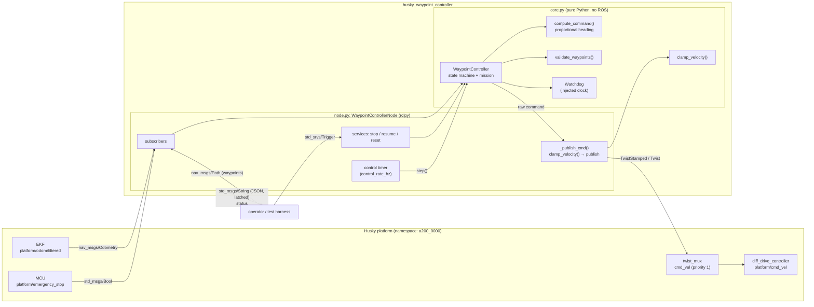
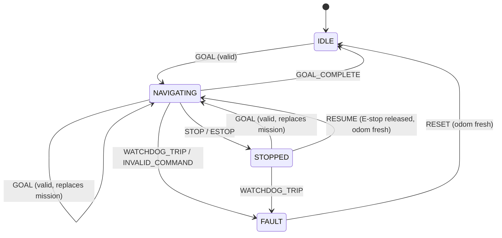
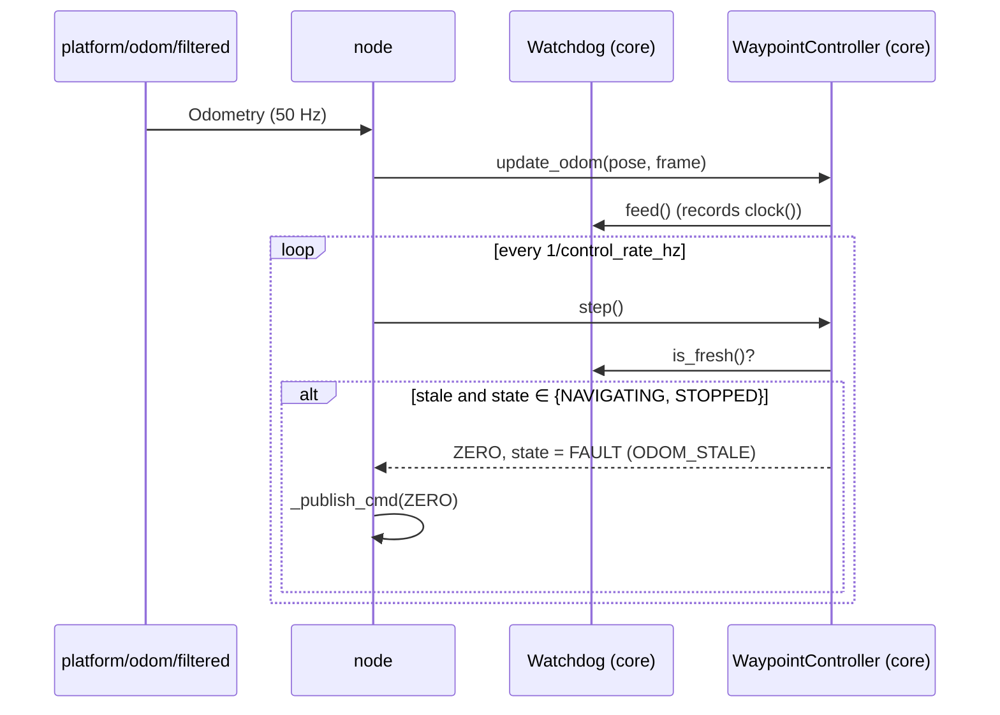

# Design: Husky Waypoint Controller

| | |
| --- | --- |
| **Document** | `docs/design.md` |
| **Version** | 0.1 (**DRAFT**) |
| **Implements** | `docs/requirements.md` v0.1 |
| **Package** | `src/husky_waypoint_controller` |

## 1. Decisions

Defaults chosen for the open questions in `requirements.md` §6. Revisit them in review.

| # | Question | Decision | Why |
| --- | --- | --- | --- |
| D1 | Control law | Proportional heading control, with rotate-in-place and final-waypoint slowdown | Simple to reason about and test. Good enough for straight segments between waypoints. Pure pursuit can replace `compute_command` later without touching anything else. |
| D2 | Goal interface | `nav_msgs/Path` **topic** plus `std_srvs/Trigger` services | Uses only standard types. An action would need a separate `ament_cmake` interface package. Goal rejections are reported on the status topic (see §3.3). |
| D3 | Default speed | 0.5 m/s, 0.8 rad/s | Half the platform cap leaves margin for the acceleration limit and turns. |
| D4 | E-stop during a mission | Keep the mission and enter STOPPED; resume is explicit | Matches REQ-SAFE-002. |
| D5 | Reference course | 5 m square only (REQ-NAV-007) | A sharp-turn course can be added later. |
| D6 | `cmd_vel` type | `TwistStamped` by default; `Twist` when `cmd_vel_stamped: false` | Jazzy's `twist_mux` and diff-drive controller only accept `TwistStamped`, so plain `Twist` messages would never reach the wheels. Humble needs `Twist`. |

## 2. Node architecture

All control logic lives in `core.py`, which has no ROS imports (REQ-ARCH-001). `node.py` is a thin adapter (REQ-ARCH-003).



**Data flow per control cycle:**
1. The timer calls `WaypointController.step()`.
2. `step()` checks the watchdog and consumes any reached waypoints.
3. It calls `compute_command()` and returns a raw command.
4. The node passes that command to `_publish_cmd()`, which applies `clamp_velocity()` and then publishes. `_publish_cmd()` is the **only** place `cmd_vel` is published (enforced by `test_cmd_vel_is_published_only_through_the_clamp`).

## 3. Interfaces

Husky topics resolve to `/<namespace>/<topic>` (REQ-IF-001). The controller's own interfaces are relative to the node: launched without a namespace, they are `/waypoints`, `/status`, `/stop`, `/resume` and `/reset`.

### 3.1 Topics

| Name | Direction | Type | QoS | Notes | Requirements |
| --- | --- | --- | --- | --- | --- |
| `/<ns>/cmd_vel` | publish | `geometry_msgs/TwistStamped` (or `Twist`) | reliable, depth 10 | `header.frame_id = base_frame_id`; published every cycle while NAVIGATING, plus one zero when leaving it | REQ-IF-002, REQ-CTL-005, REQ-SM-008 |
| `/<ns>/<odom_topic>` | subscribe | `nav_msgs/Odometry` | sensor data (best effort) | Feeds the watchdog; frame used for REQ-WPT-005 | REQ-IF-003, REQ-SAFE-003 |
| `/<ns>/platform/emergency_stop` | subscribe | `std_msgs/Bool` | reliable, depth 10 | `true` = asserted | REQ-IF-004, REQ-SAFE-001 |
| `waypoints` | subscribe | `nav_msgs/Path` | reliable, depth 10 | Only `pose.position.x/y` are used; `header.frame_id` must match the odom frame | REQ-IF-005, REQ-WPT-* |
| `status` | publish | `std_msgs/String` (JSON) | reliable, transient local, depth 1 | Published on change; late subscribers get the latest | REQ-SM-009, REQ-WPT-006 |

Status JSON:

```json
{"state": "NAVIGATING", "reason": "GOAL_ACCEPTED", "waypoint_index": 1, "waypoint_count": 4,
 "estop_active": false, "last_goal": {"accepted": true, "reason": "GOAL_ACCEPTED"}}
```

### 3.2 Services (`std_srvs/Trigger`)

`success` is the request outcome and `message` is the `Reason` value.

| Name | Accepted when | Rejection reasons | Requirements |
| --- | --- | --- | --- |
| `stop` | NAVIGATING → STOPPED. IDLE or STOPPED returns success with `ALREADY_STOPPED` | `IN_FAULT` | REQ-SM-004 |
| `resume` | STOPPED, E-stop released, odometry fresh | `NOT_STOPPED`, `ESTOP_ACTIVE`, `ODOM_STALE` | REQ-SM-005, REQ-SAFE-002 |
| `reset` | FAULT and odometry fresh → IDLE, mission cleared | `NOT_IN_FAULT`, `ODOM_STALE` | REQ-SM-006 |

### 3.3 Goal rejection reasons

Reported in `status.last_goal` and in the node log (REQ-WPT-006). They are checked in this order:

1. `IN_FAULT` (REQ-SM-007)
2. `NO_ODOM`: no odometry yet, or it is stale (REQ-SAFE-005)
3. `ESTOP_ACTIVE`
4. `EMPTY` (REQ-WPT-001)
5. `TOO_MANY` (REQ-WPT-003)
6. `WRONG_FRAME` (REQ-WPT-005)
7. `NON_FINITE` (REQ-WPT-002)
8. `OUT_OF_RANGE` (REQ-WPT-004)

### 3.4 Parameters

All values live in `config/params.yaml`. The node declares parameters **without defaults** and refuses to start if any are missing or out of range, logging every problem (REQ-IF-006).

| Parameter | Type | Default (yaml) | Allowed | Used by | Requirements |
| --- | --- | --- | --- | --- | --- |
| `namespace` | string | `a200_0000` | non-empty | node | REQ-IF-001 |
| `odom_topic` | string | `platform/odom/filtered` | non-empty | node | REQ-IF-003 |
| `cmd_vel_stamped` | bool | `true` | — | node | REQ-IF-002 |
| `base_frame_id` | string | `base_link` | non-empty | node | REQ-IF-002 |
| `goal_tolerance_m` | double | 0.20 | (0, 2.0] | core | REQ-NAV-001 |
| `rotate_in_place_threshold_rad` | double | 0.785 | (0, π] | core | REQ-NAV-005 |
| `slowdown_radius_m` | double | 1.0 | [0, 10] | core | REQ-NAV-006 |
| `heading_gain` | double | 1.5 | (0, 10] | core | REQ-NAV-004 |
| `max_linear_speed_mps` | double | 0.5 | (0, 1.0] | core | REQ-CTL-001 |
| `max_angular_speed_radps` | double | 0.8 | (0, 1.0] | core | REQ-CTL-002 |
| `max_linear_accel_mps2` | double | 0.5 | (0, 2.0] | core | REQ-CTL-003 |
| `control_rate_hz` | double | 20.0 | [5, 100] | both | REQ-CTL-005 |
| `max_waypoints` | int | 100 | [1, 1000] | core | REQ-WPT-003 |
| `max_waypoint_range_m` | double | 50.0 | (0, 500] | core | REQ-WPT-004 |
| `odom_timeout_s` | double | 0.2 | (0, 0.5) | core | REQ-SAFE-003, REQ-SAFE-006 |
| `use_sim_time` | bool | `true` (launch arg) | — | node | REQ-SAFE-007 |

`heading_gain` is new in the design (it isn't in `requirements.md` §5). It should be added there in the next revision.

## 4. Controller state machine



- The table lives in `core.TRANSITIONS`. Any (state, event) pair not in it is refused and logged (REQ-SM-010).
- Outside NAVIGATING, `step()` returns zero. The node publishes one zero command whenever it leaves NAVIGATING, either immediately from a callback (E-stop, stop service, new goal) or on the next tick (watchdog, completion) (REQ-SM-008, REQ-SAFE-001).
- E-stop in FAULT does not change state, and goals in FAULT are rejected (REQ-SM-007).

## 5. Control law (`compute_command`)

For the current target waypoint, with heading error `e = wrap(atan2(dy, dx) − yaw)` in [−π, π):

```
ω = heading_gain · e                                                  (REQ-NAV-004)
v = 0                                 if |e| > rotate_in_place_threshold (REQ-NAV-005)
v = max_linear_speed · cos(e)         otherwise
v ← v · min(1, d / slowdown_radius)   on the final waypoint only      (REQ-NAV-006)
```

A waypoint is reached when its distance is ≤ `goal_tolerance_m`. Reached waypoints are consumed in order before computing the command (REQ-NAV-001, REQ-NAV-002). The result is **unclamped**: limits are applied only by `clamp_velocity`.

## 6. Velocity clamp (`clamp_velocity`)

This is the last step before every publish, inside `_publish_cmd()`. No code path can skip it: the static test checks that `_cmd_pub.publish` appears exactly once, after `clamp_velocity`. The clamp applies these rules in order:

1. Non-finite linear or angular → zero command (REQ-CTL-006).
2. `v` clamped to [0, `max_linear_speed`]; no reverse (REQ-CTL-001, REQ-CTL-004).
3. `ω` clamped to [−`max_angular_speed`, `max_angular_speed`] (REQ-CTL-002).
4. If `v ≠ 0`, it may change by at most `max_linear_accel · period` from the previously published value. A command of exactly zero always passes, so stops are immediate (REQ-CTL-003).

## 7. Watchdog design



- **Clock injection.** `Watchdog(timeout_s, clock)` takes any `() -> float` (seconds). The node passes the ROS clock when `use_sim_time` is true, so it follows Gazebo's `/clock`, and a steady (monotonic) clock otherwise. Tests pass a `FakeClock` (REQ-SAFE-007).
- **Freshness.** Fresh means fed at least once and `0 ≤ now − last_feed ≤ odom_timeout_s`. Never fed counts as stale. A clock that jumped backwards (e.g. simulation reset) counts as stale until the next message (REQ-SAFE-007).
- **Bad data.** Non-finite poses are dropped and don't feed the watchdog, so corrupted odometry trips it like missing odometry.
- **Detection latency.** The watchdog is checked once per cycle, so a timeout is detected at most `odom_timeout_s + 1/control_rate_hz` after the last message: 0.25 s with the defaults (REQ-SAFE-004).
- **Layered safety.** `odom_timeout_s` must be below the platform's 0.5 s command timeout (enforced in `PARAM_RANGES`, REQ-SAFE-006). If this node crashes or hangs, `twist_mux` and the diff-drive controller stop the robot within 0.5 s on their own (REQ-SAFE-008).
- **Scope.** The watchdog only acts in NAVIGATING and STOPPED. In IDLE it simply makes goals fail with `NO_ODOM` (REQ-SAFE-005).

## 8. Requirement → design traceability

**Test** refers to tests in `src/husky_waypoint_controller/test/`. "—" means verification is still to come: integration (I), simulation (S) or inspection (X), per `requirements.md`.

| Requirement | Design element | Unit test |
| --- | --- | --- |
| REQ-NAV-001 | `WaypointController._reached`, `goal_tolerance_m` | `test_advances_only_after_current_waypoint_is_reached`, `test_waypoint_exactly_at_tolerance_counts_as_reached` |
| REQ-NAV-002 | `step()` consumes waypoints by index | `test_advances_only_after_current_waypoint_is_reached` |
| REQ-NAV-003 | `step()` → `GOAL_COMPLETE`, returns `ZERO` | `test_final_waypoint_completes_mission_with_zero_command` |
| REQ-NAV-004 | `compute_command`, `wrap_angle`, `heading_gain` | `test_angular_command_turns_toward_target_the_short_way`, `test_wrap_angle_range` |
| REQ-NAV-005 | `compute_command` rotate-in-place branch | `test_rotates_in_place_when_heading_error_is_large` |
| REQ-NAV-006 | `compute_command` final-waypoint slowdown | `test_slows_down_only_near_final_waypoint` |
| REQ-NAV-007 | Whole system in Gazebo | — (S) |
| REQ-WPT-001…005 | `validate_waypoints`, `validate_waypoint` | `test_rejects_*` |
| REQ-WPT-006 | `submit_goal` only mutates on acceptance; `status.last_goal` | `test_rejected_goal_leaves_state_and_mission_unchanged` |
| REQ-CTL-001, -002, -004 | `clamp_velocity`, `PARAM_RANGES`, `_publish_cmd` | `test_linear_speed_clamped_to_zero_and_max`, `test_angular_speed_clamped`, `test_closed_loop_commands_respect_limits_after_clamp`, `test_cmd_vel_is_published_only_through_the_clamp` |
| REQ-CTL-003 | `clamp_velocity` acceleration step | `test_linear_acceleration_limited_except_for_stops` |
| REQ-CTL-005 | Node timer at `control_rate_hz` | — (I) |
| REQ-CTL-006 | `clamp_velocity` non-finite guard; `step()` → `INVALID_COMMAND` | `test_clamp_turns_non_finite_into_zero`, `test_non_finite_control_output_faults` |
| REQ-SM-001…008, -010 | `WaypointController`, `TRANSITIONS` | `test_starts_idle` … `test_events_outside_transition_table_are_refused` |
| REQ-SM-009 | `Status.to_dict`, latched `status` topic | `test_status_snapshot_is_serializable` (+ I for latching) |
| REQ-SAFE-001, -002 | `set_estop`, `_apply` immediate zero | `test_estop_*` |
| REQ-SAFE-003, -004 | `Watchdog`, `step()` | `test_stale_odometry_trips_watchdog_into_fault`, `test_watchdog_also_guards_stopped_state`, `test_non_finite_odometry_is_ignored_and_goes_stale` |
| REQ-SAFE-005 | `_check_goal` | `test_goal_rejected_without_fresh_odometry` |
| REQ-SAFE-006 | `PARAM_RANGES["odom_timeout_s"]` | `test_odom_timeout_must_stay_below_platform_timeout`, `test_params_yaml_defines_every_core_parameter_with_valid_values` |
| REQ-SAFE-007 | `Watchdog` clock injection, backwards-jump check | `test_clock_jumping_backwards_counts_as_stale` |
| REQ-SAFE-008 | Platform `cmd_vel_timeout` (0.5 s) | — (S) |
| REQ-IF-001…005 | `node.py` topic and service wiring | — (I) |
| REQ-IF-006 | `_load_params` (no defaults), `validate_params` | `test_validate_params_reports_every_violation`, `test_max_waypoints_must_be_an_integer`, `test_params_yaml_defines_every_core_parameter_with_valid_values` |
| REQ-IF-007 | Only `/<ns>/cmd_vel` is published | `test_node_never_targets_platform_cmd_vel` |
| REQ-ARCH-001 | `core.py` imports | `test_core_has_no_ros_imports` |
| REQ-ARCH-002 | No clock reads in core except the injected one | `test_identical_inputs_give_identical_outputs` |
| REQ-ARCH-003 | `node.py` contains no control logic | `test_cmd_vel_is_published_only_through_the_clamp` (+ X) |
| REQ-ARCH-004 | `pythonpath` in `pyproject.toml`; tests import only `core` | `make unit` on a host without ROS (X) |

## 9. Running

```bash
# Inside the Jazzy container (make docker-shell), with the Husky simulation running:
source /opt/ros/jazzy/setup.bash
make build && source install/setup.bash
ros2 launch husky_waypoint_controller waypoint_controller.launch.py

# Send a goal (frame must match odometry, usually "odom")
ros2 topic pub --once /waypoints nav_msgs/msg/Path \
  "{header: {frame_id: odom}, poses: [{pose: {position: {x: 2.0, y: 0.0}}}, {pose: {position: {x: 2.0, y: 2.0}}}]}"

ros2 topic echo /status
ros2 service call /stop std_srvs/srv/Trigger
ros2 service call /resume std_srvs/srv/Trigger
```
